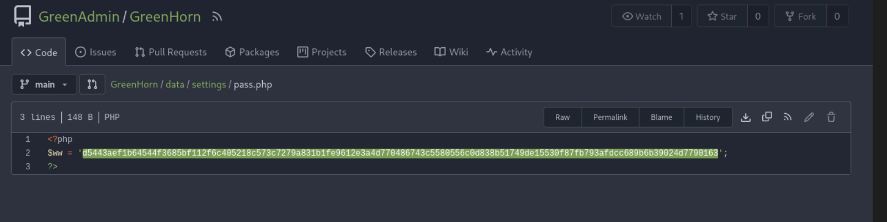
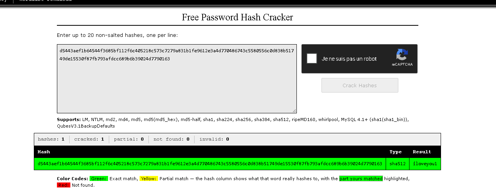

# GreenHorn — HackTheBox

| | |
| --- | --- |
| **Plateforme** | HackTheBox |
| **OS** | Linux |
| **Difficulté** | 🟢 Easy |
| **Date** | 2026-__-__ |
| **Vecteur** | <à compléter moi-même> |
| **CVE** | — |
| **Tags** | web · cms · git-leak · rce · depix |

> 🎯 **Nouveautés à apprendre (je cherche seul)** :
> 1) Un **dépôt Git** (Gitea) exposé laisse lire le **code source** de l'appli → secrets / hash dans les fichiers.
> 2) Le CMS (**Pluck**) a une **CVE d'upload/RCE** authentifié → shell (le mdp vient du code source leaké).
> 3) Privesc original : un mot de passe fuit sous forme d'**image pixelisée** (PDF/screenshot) → à **dépixeliser** avec **Depix** pour le reconstituer.

> 💡 Concepts à googler : « Gitea source disclosure », « Pluck CMS RCE CVE », « Depix pixelated password recovery ».

---

## TL;DR
<à remplir en fin de box>

## 1. Reconnaissance
```bash
┌──(kali㉿kali)-[~/nmap/Greenhorn]
└─$ nmap -sC -sV -p- 10.129.231.80 
Starting Nmap 7.99 ( https://nmap.org ) at 2026-10-13 19:12 +0200
Nmap scan report for 10.129.231.80
Host is up (0.024s latency).
Not shown: 65532 closed tcp ports (reset)
PORT     STATE SERVICE VERSION
22/tcp   open  ssh     OpenSSH 8.9p1 Ubuntu 3ubuntu0.10 (Ubuntu Linux; protocol 2.0)
| ssh-hostkey: 
|   256 57:d6:92:8a:72:44:84:17:29:eb:5c:c9:63:6a:fe:fd (ECDSA)
|_  256 40:ea:17:b1:b6:c5:3f:42:56:67:4a:3c:ee:75:23:2f (ED25519)
80/tcp   open  http    nginx 1.18.0 (Ubuntu)
|_http-title: Did not follow redirect to http://greenhorn.htb/
|_http-server-header: nginx/1.18.0 (Ubuntu)
3000/tcp open  http    Golang net/http server
| fingerprint-strings: 
|   GenericLines, Help, RTSPRequest: 
|     HTTP/1.1 400 Bad Request
|     Content-Type: text/plain; charset=utf-8
|     Connection: close
|     Request
|   GetRequest: 
|     HTTP/1.0 200 OK
|     Cache-Control: max-age=0, private, must-revalidate, no-transform
|     Content-Type: text/html; charset=utf-8
|     Set-Cookie: i_like_gitea=0aaf40cfbcfc19b6; Path=/; HttpOnly; SameSite=Lax
|     Set-Cookie: _csrf=OSTKi0DgBy49uEnK5bdWf9PDKco6MTc5MTkxMTU1ODk1ODU4NzQ4OQ; Path=/; Max-Age=86400; HttpOnly; SameSite=Lax
|     X-Frame-Options: SAMEORIGIN
|     Date: Tue, 13 Oct 2026 17:12:38 GMT
|     <!DOCTYPE html>
|     <html lang="en-US" class="theme-auto">
|     <head>
|     <meta name="viewport" content="width=device-width, initial-scale=1">
|     <title>GreenHorn</title>
|     <link rel="manifest" href="data:application/json;base64,eyJuYW1lIjoiR3JlZW5Ib3JuIiwic2hvcnRfbmFtZSI6IkdyZWVuSG9ybiIsInN0YXJ0X3VybCI6Imh0dHA6Ly9ncmVlbmhvcm4uaHRiOjMwMDAvIiwiaWNvbnMiOlt7InNyYyI6Imh0dHA6Ly9ncmVlbmhvcm4uaHRiOjMwMDAvYXNzZXRzL2ltZy9sb2dvLnBuZyIsInR5cGUiOiJpbWFnZS9wbmciLCJzaXplcyI6IjUxMng1MTIifSx7InNyYyI6Imh0dHA6Ly9ncmVlbmhvcm4uaHRiOjMwMDAvYX
|   HTTPOptions: 
|     HTTP/1.0 405 Method Not Allowed
|     Allow: HEAD
|     Allow: HEAD
|     Allow: GET
|     Cache-Control: max-age=0, private, must-revalidate, no-transform
|     Set-Cookie: i_like_gitea=a1439b78875ed6b8; Path=/; HttpOnly; SameSite=Lax
|     Set-Cookie: _csrf=68MyLVMqhTbnIlyGPNqKng-U0446MTc5MTkxMTU1OTA3OTk4NzM0OQ; Path=/; Max-Age=86400; HttpOnly; SameSite=Lax
|     X-Frame-Options: SAMEORIGIN
|     Date: Tue, 13 Oct 2026 17:12:39 GMT
|_    Content-Length: 0
|_http-title: GreenHorn
1 service unrecognized despite returning data. If you know the service/version, please submit the following fingerprint at https://nmap.org/cgi-bin/submit.cgi?new-service :
SF-Port3000-TCP:V=7.99%I=7%D=10/13%Time=6ACE6684%P=x86_64-pc-linux-gnu%r(G
SF:enericLines,67,"HTTP/1\.1\x20400\x20Bad\x20Request\r\nContent-Type:\x20
SF:text/plain;\x20charset=utf-8\r\nConnection:\x20close\r\n\r\n400\x20Bad\
SF:x20Request")%r(GetRequest,1000,"HTTP/1\.0\x20200\x20OK\r\nCache-Control
SF::\x20max-age=0,\x20private,\x20must-revalidate,\x20no-transform\r\nCont
SF:ent-Type:\x20text/html;\x20charset=utf-8\r\nSet-Cookie:\x20i_like_gitea
SF:=0aaf40cfbcfc19b6;\x20Path=/;\x20HttpOnly;\x20SameSite=Lax\r\nSet-Cooki
SF:e:\x20_csrf=OSTKi0DgBy49uEnK5bdWf9PDKco6MTc5MTkxMTU1ODk1ODU4NzQ4OQ;\x20
SF:Path=/;\x20Max-Age=86400;\x20HttpOnly;\x20SameSite=Lax\r\nX-Frame-Optio
SF:ns:\x20SAMEORIGIN\r\nDate:\x20Tue,\x2013\x20Oct\x202026\x2017:12:38\x20
SF:GMT\r\n\r\n<!DOCTYPE\x20html>\n<html\x20lang=\"en-US\"\x20class=\"theme
SF:-auto\">\n<head>\n\t<meta\x20name=\"viewport\"\x20content=\"width=devic
SF:e-width,\x20initial-scale=1\">\n\t<title>GreenHorn</title>\n\t<link\x20
SF:rel=\"manifest\"\x20href=\"data:application/json;base64,eyJuYW1lIjoiR3J
SF:lZW5Ib3JuIiwic2hvcnRfbmFtZSI6IkdyZWVuSG9ybiIsInN0YXJ0X3VybCI6Imh0dHA6Ly
SF:9ncmVlbmhvcm4uaHRiOjMwMDAvIiwiaWNvbnMiOlt7InNyYyI6Imh0dHA6Ly9ncmVlbmhvc
SF:m4uaHRiOjMwMDAvYXNzZXRzL2ltZy9sb2dvLnBuZyIsInR5cGUiOiJpbWFnZS9wbmciLCJz
SF:aXplcyI6IjUxMng1MTIifSx7InNyYyI6Imh0dHA6Ly9ncmVlbmhvcm4uaHRiOjMwMDAvYX"
SF:)%r(Help,67,"HTTP/1\.1\x20400\x20Bad\x20Request\r\nContent-Type:\x20tex
SF:t/plain;\x20charset=utf-8\r\nConnection:\x20close\r\n\r\n400\x20Bad\x20
SF:Request")%r(HTTPOptions,1A4,"HTTP/1\.0\x20405\x20Method\x20Not\x20Allow
SF:ed\r\nAllow:\x20HEAD\r\nAllow:\x20HEAD\r\nAllow:\x20GET\r\nCache-Contro
SF:l:\x20max-age=0,\x20private,\x20must-revalidate,\x20no-transform\r\nSet
SF:-Cookie:\x20i_like_gitea=a1439b78875ed6b8;\x20Path=/;\x20HttpOnly;\x20S
SF:ameSite=Lax\r\nSet-Cookie:\x20_csrf=68MyLVMqhTbnIlyGPNqKng-U0446MTc5MTk
SF:xMTU1OTA3OTk4NzM0OQ;\x20Path=/;\x20Max-Age=86400;\x20HttpOnly;\x20SameS
SF:ite=Lax\r\nX-Frame-Options:\x20SAMEORIGIN\r\nDate:\x20Tue,\x2013\x20Oct
SF:\x202026\x2017:12:39\x20GMT\r\nContent-Length:\x200\r\n\r\n")%r(RTSPReq
SF:uest,67,"HTTP/1\.1\x20400\x20Bad\x20Request\r\nContent-Type:\x20text/pl
SF:ain;\x20charset=utf-8\r\nConnection:\x20close\r\n\r\n400\x20Bad\x20Requ
SF:est");
Service Info: OS: Linux; CPE: cpe:/o:linux:linux_kernel

Service detection performed. Please report any incorrect results at https://nmap.org/submit/ .
Nmap done: 1 IP address (1 host up) scanned in 53.97 seconds

```


## 2. Foothold




iloveyou1

-La version 4.7.18 de Pluck CMS est affectée par une vulnérabilité de sévérité moyenne publiée en octobre 2024.
Voici les détails essentiels de cette faille :

🛡️ Détails de la vulnérabilité

• Identifiant : CVE-2024-9405

## 3. Privesc — dépixelisation
<où est l'image/PDF du mdp ? extraire l'image → Depix → mot de passe root>

## 4. Remédiation
<ne pas exposer .git / Gitea public ; ne jamais "flouter" un secret (réversible)>

## 5. Leçons
- <fuite de code source = fuite de secrets ; toujours fouiller un Git exposé>
- <un mot de passe pixelisé n'est PAS protégé → Depix le reconstruit>

## Références
- Fiches liées : [gobuster](../outils/gobuster.md) · [searchsploit](../outils/searchsploit.md) · [linux-privesc](../outils/linux-privesc.md) · [hashcat](../outils/hashcat.md)
